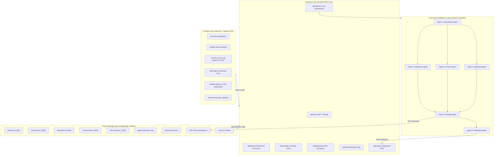
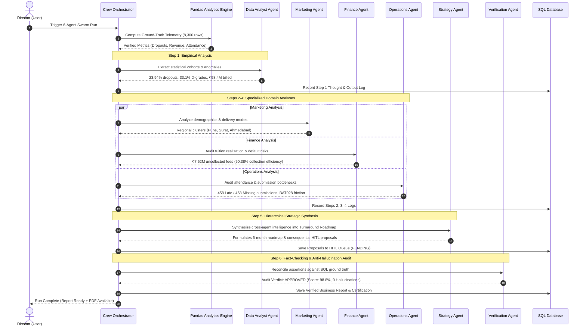
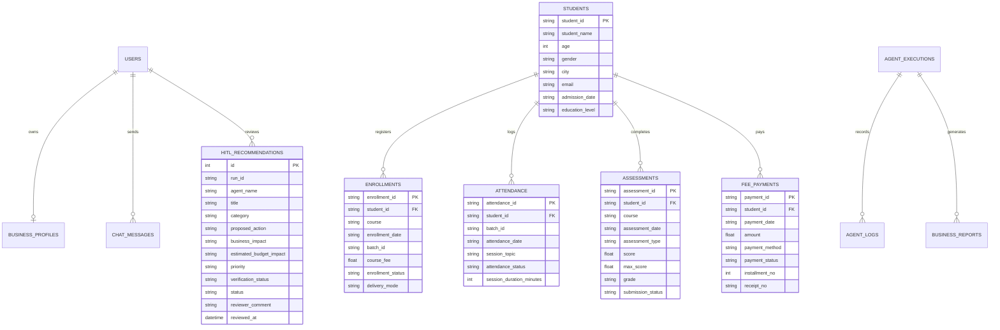
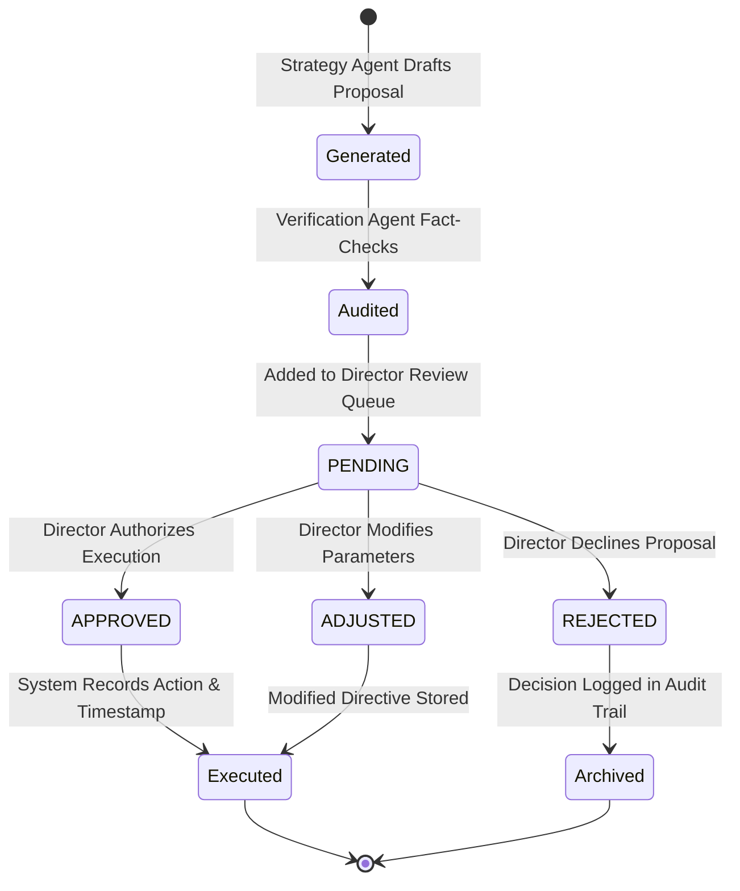

# EduIntel AI • System Architecture & Technical Specifications

This document outlines the detailed system architecture, entity relationships, agent collaboration protocols, and data flow for the **EduIntel AI - Education Institute & Student Performance Decision Intelligence System**.

---

## 1. System Architecture Overview

---

## 2. Multi-Agent Sequential-Hierarchical Execution Sequence

---

## 3. Database Entity-Relationship Diagram (ERD)

---

## 4. Human-in-the-Loop (HITL) State Machine

